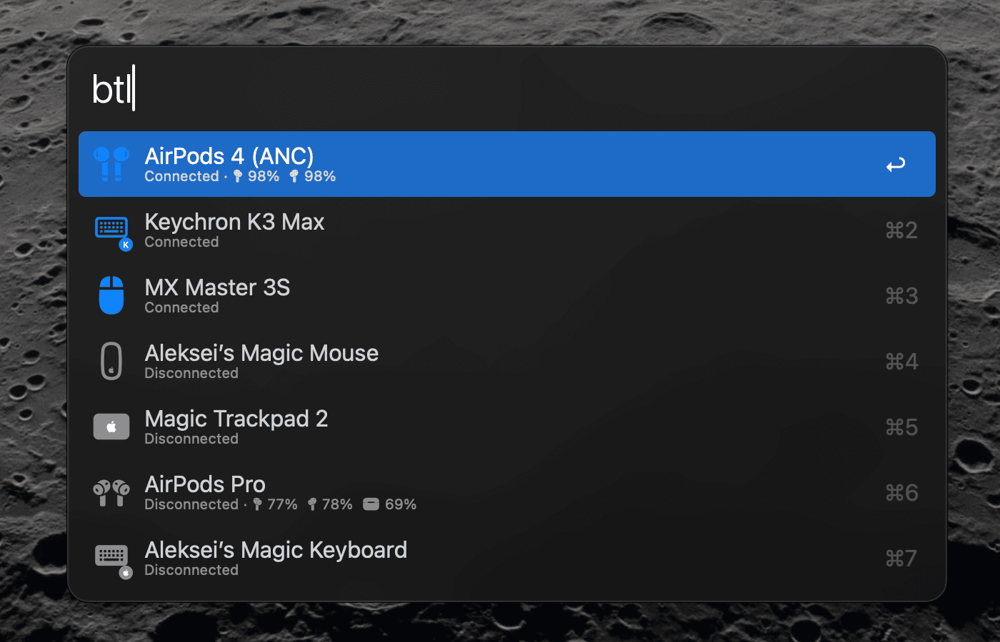
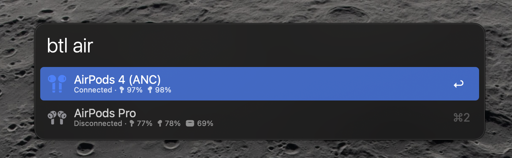
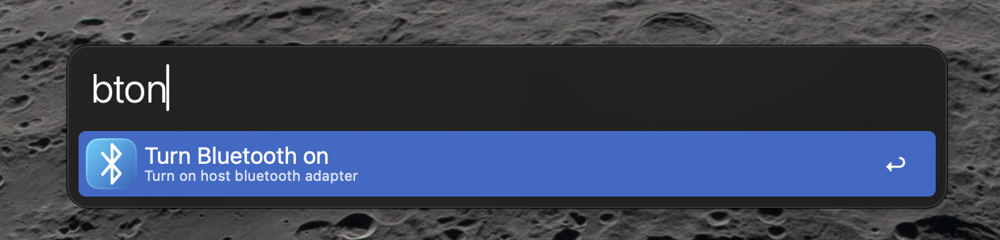
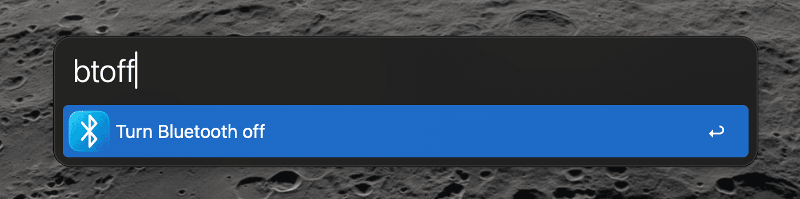

# Alfred Workflow for Controlling Bluetooth Connection

This workflow enables you to manage your Bluetooth device connections and Bluetooth state directly from Alfred. It offers the following functionalities:

* Displays a list of all paired devices along with their connection status (connected or disconnected).
* Connects or disconnects from a paired Bluetooth device.
* Turns Bluetooth on or off for your device.

Compared to other workflows such as [alfred_bluetooth_controller](https://github.com/vegardinho/alfred_bluetooth_controller/), this one:

* Utilizes only JavaScript (JXA - JavaScript for Automations), which is included with every modern MacOS and proven to be stable enough (you all probably remember the pain when apple moved from python2 to python3, right? 😬 ). No need for additional interpreters or external libraries.
* Does not require any external programs like 'blueutil'.
* Leverages native JXA bridges and MacOS APIs, resulting in faster performance compared to workflows relying on external programs.

## Compatibility

I initially developed this workflow for Alfred 4 and it should work seamlessly with both versions 4 and 5. I don't currently have access to Alfred 4, so cannot ensure full compatibility.

Regarding MacOS version and devices: This workflow functions perfectly on my MacBook Air (M1 chip), the latest MacOS versions, and should operate without issue on any M-based Mac. Compatibility with older non-M chips is unverified. Feel free to report bugs or submit pull requests.

## Screenshots





## Installation

1. Download the latest workflow from the 'Releases' page.
2. Double-click the downloaded file to install it.
3. When you first try to use the workflow, you will be prompted for access to the scripting engine. Grant permission to allow the workflow to function properly.
4. Set up your desired keyboard shortcuts (if any).
5. Begin using it.

## Commands

* **btl**: Displays a list of all paired Bluetooth devices and their connection status.
* **bton**: Turns on Bluetooth on your device.
* **btoff**: Turns off Bluetooth on your device.

## Troubleshooting

### Bluetooth permission (macOS Sonoma 14 and newer)

Starting with macOS Sonoma (14), access to the IOBluetooth framework is gated by the Bluetooth privacy permission (TCC). The permission is attributed to the app that runs the workflow — Alfred — and because Alfred does not declare Bluetooth usage in its bundle, **macOS will never show a permission prompt**: the workflow just silently misbehaves (device connection status missing in the list, power toggle and connect/disconnect doing nothing).

Grant the permission manually:

1. Open `System Settings -> Privacy & Security -> Bluetooth`
2. Press the ➕ button and add the Alfred you are using (e.g. `Alfred 5.app` from `/Applications`)
3. Make sure the toggle next to Alfred is enabled

If the workflow worked before and broke right after a macOS upgrade, the grant may have been scrambled by the upgrade. Reset it and grant again:

```shell
tccutil reset All com.runningwithcrayons.Alfred
```

### Disconnecting devices on macOS 26.2 and newer

On macOS 26.2+ (Tahoe and later) the Bluetooth disconnect API appears to be broken: `closeConnection` is accepted but silently does nothing, and there is no public replacement API. This is not a JXA limitation and not specific to this workflow — even [blueutil](https://github.com/toy/blueutil), the de-facto standard Bluetooth CLI for macOS, [cannot disconnect devices on modern macOS versions](https://github.com/toy/blueutil/issues/58) (the issue has been open since Monterey and remains unresolved).

The workflow attempts the disconnect anyway, verifies whether it actually happened, and reports an error when it did not. On macOS versions where the API works, disconnecting functions normally. If Apple fixes this in a future update, disconnecting will start working again automatically — no workflow update needed.

## Settings

Currently, it supports only one configuration parameter named 'debug level'. The default value is set to 'INFO'. You don't need to modify this unless you encounter issues with the workflow.